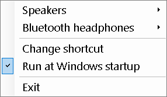

# EarFlip


One hotkey to flip your Windows audio between speakers and Bluetooth headphones.
A tiny replacement for SoundSwitch: no installer, no notifications, no sound, no settings window.

<br clear="left" />

[](https://github.com/alimwork85-web/EarFlip/releases/latest)
[](https://github.com/alimwork85-web/EarFlip/actions/workflows/build.yml)


---

## Features

- **`Ctrl + Alt + F12`** switches the default playback device between speakers and your Bluetooth headphones — all three Windows roles (console, multimedia, communications) at once.
- **Tray icon that tells the truth:** a blue headset when the headphones are the active output, an orange speaker otherwise. Hover to see the current device name.
- **Works on any machine:** the two slots are chosen from the tray menu (*System speaker ▸* / *Bluetooth headset ▸*) and saved under `HKCU\Software\EarFlip`. On first run the app picks the current output as the speaker side and the first Bluetooth headset as the other one; a headset that got re-paired is matched back by name.
- **Left click the icon to flip**, right click still opens the menu.
- **Silent by design.** No balloon, no beep, no toast. If the headphones are disconnected, the icon blinks grey three times instead of doing nothing.
- **Watches Windows too:** change the device from Settings and the icon reacts at once — device notifications, not polling. The 2 s poll only runs if Windows refuses the callback.
- **Right-click menu:** *System speaker* ▸ · *Bluetooth headset* ▸ · *Change shortcut* · *Run at Windows startup* · *Exit*.
- **Single instance**, and the hotkey is released on exit.
- **One small exe**, no framework install, no dependencies, no registry clutter (only your chosen devices and shortcut, under `HKCU\Software\EarFlip`).

## Screenshots

| Tray menu | Change shortcut |
|---|---|
|  |  |

| Headphones active | Speakers active |
|---|---|
|  |  |

## Resource usage

Measured on Windows 11 with the released `EarFlip.exe` (1.2.0):

| Metric | Value |
|---|---|
| Executable size | **24.5 KB** (25,088 bytes) |
| Working set (RAM) | **~39 MB** (private ~24 MB) |
| CPU while idle | **0.00 s over 15 s** of sampling — below 0.01% of one core |
| Threads | 13 |
| Background polling | **none** — an `IMMNotificationClient` callback; a 2000 ms poll only if Windows refuses to register it |
| Dependencies | none — in-box .NET Framework 4.x only |

## Install

1. Download `EarFlip.exe` from the [latest release](../../releases/latest).
2. Put it anywhere and run it once. It lives in the notification area and starts with Windows (tick *Run at Windows startup* in the tray menu).
3. Press `Ctrl + Alt + F12`.

Windows SmartScreen may warn about an unsigned exe — *More info → Run anyway*.

## Usage

| Action | Result |
|---|---|
| `Ctrl + Alt + F12` | Switch output: speakers ⇄ Bluetooth headphones |
| Left click the tray icon | Same as the hotkey |
| Tray icon (hover) | Name of the current output device |
| Right-click → *System speaker ▸* | Pick which device counts as "speakers" (the list shows active and disconnected devices) |
| Right-click → *Bluetooth headset ▸* | Pick which device counts as "Bluetooth headphones" |
| Right-click → *Change shortcut* | Press the new combination (needs Ctrl/Alt/Shift); Esc cancels |
| Right-click → *Run at Windows startup* | Tick/untick autostart (a shortcut in your Startup folder; a stale one is rebuilt on the next launch) |
| Right-click → *Exit* | Quits and releases the hotkey |

## Build from source

The build uses the C# compiler that already ships with Windows — no SDK, no NuGet.

```cmd
build.cmd
```

It compiles `EarFlip.cs` → runs `EarFlip.exe --make-icon` (writes `EarFlip.ico` from the same GDI+ routine the tray uses) → recompiles with `/win32icon`. CI does the same thing on every tag and attaches the exe to the release.

## Notes

- Nothing about your hardware is compiled in. The two chosen devices live in `HKCU\Software\EarFlip` (`Speakers`, `SpeakersName`, `Buds`, `BudsName`), together with the shortcut (`Modifiers`, `Key`). Delete the key and the next launch picks the current output plus the first Bluetooth headset again.
- The icon follows Windows immediately through `IMMNotificationClient` (default device, device state, add/remove, property changes); `RefreshTray` is always called on the UI thread. If registering the callback ever fails, the app falls back to polling every 2 seconds.
- Version resources: *Properties → Details* on the exe shows **Ali Alhumedi** as company/publisher and the current version.

## License

Released by **Ali Alhumedi**. Free to use and modify; keep the credit.

`#EarFlip` `#Windows` `#CSharp` `#WinForms` `#TrayApp` `#AudioSwitcher` `#Bluetooth` `#Productivity` `#OpenSource` `#TinyTools` `#NoDependencies` `#SilentByDesign`

---

<div dir="rtl">

## بالعربية

**EarFlip** أداة صغيرة لـ Windows وظيفتها واحدة: اختصار `Ctrl + Alt + F12` يبدّل الصوت بين مكبّر صوت الجهاز وسماعة البلوتوث.

### المزايا
- تبديل الجهاز الافتراضي للأدوار الثلاثة (console وmultimedia وcommunications) بضغطة واحدة.
- **يعمل على أي جهاز:** الجهازان يُختاران من قائمة الـ tray (**سماعة الجهاز ▸** و**سماعة البلوتوث ▸**) ويُحفظان في `HKCU\Software\EarFlip`. عند أول تشغيل يختار التطبيق المخرج الحالي للجانب الأول وأول سماعة بلوتوث للجانب الثاني، والسماعة التي تُقرن من جديد تُطابَق باسمها.
- **نقرة يسرى** على الأيقونة تبدّل، والنقرة اليمنى تفتح القائمة كما هي.
- أيقونة في شريط النظام تتبع الحالة: **سماعة زرقاء** حين تكون السماعة هي المخرج، و**مكبّر برتقالي** في غير ذلك، واسم الجهاز الحالي عند التمرير.
- **صامت تمامًا:** بلا إشعارات وبلا صوت. إن كانت السماعة مفصولة تومض الأيقونة رمادية ثلاث مرات بدل ألا يحدث شيء.
- يتابع تغييرك للجهاز من إعدادات Windows فورًا عبر إشعارات النظام لا بالاستطلاع، ولا يعود للاستطلاع كل ثانيتين إلا إن رفض Windows تسجيل الإشعار.
- قائمة يمين: **سماعة الجهاز ▸** · **سماعة البلوتوث ▸** · **تبديل الاختصار** · **التشغيل عند بدء ويندوز** · **خروج**.
- نسخة واحدة فقط تعمل، والاختصار يُحرَّر عند الخروج.

### الحجم والاستهلاك
| القياس | القيمة |
|---|---|
| حجم الملف التنفيذي | **24.5 كيلوبايت** |
| الذاكرة عند التشغيل | **~39 ميجابايت** |
| المعالج في وضع السكون | **أقل من 0.01%** من نواة واحدة |
| الاعتماديات | لا شيء — .NET Framework الموجود في Windows |

### التركيب
1. حمّل `EarFlip.exe` من [أحدث إصدار](../../releases/latest).
2. شغّله مرة واحدة، وفعّل **التشغيل عند بدء ويندوز** من قائمة الأيمن إن أردته دائمًا.
3. اضغط `Ctrl + Alt + F12`.

### البناء من المصدر
```cmd
build.cmd
```
يستخدم `csc.exe` الموجود في Windows؛ لا SDK ولا حزم.

### ملاحظة
لا شيء من عتادك مضمّن في الكود. الجهازان المختاران محفوظان في `HKCU\Software\EarFlip` (القيم `Speakers` و`SpeakersName` و`Buds` و`BudsName`) مع الاختصار (`Modifiers` و`Key`). احذف المفتاح فيختار التشغيل التالي المخرج الحالي وأول سماعة بلوتوث من جديد.

</div>

<sub>Made by Ali Alhumedi · 2026</sub>
